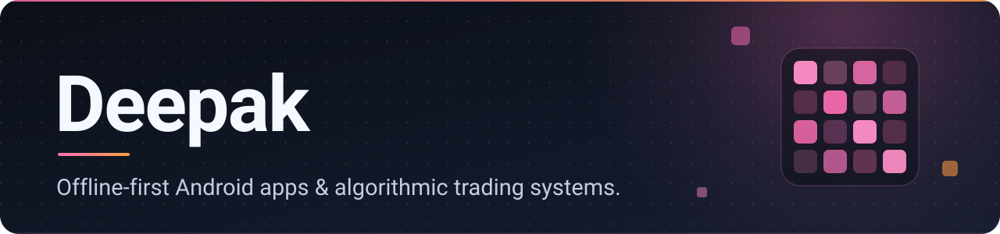

<!--
  Profile README for github.com/deepak0362002-svg
  The special repo must be named exactly "deepak0362002-svg" and contain this
  README.md plus assets/banner.svg.
-->

  

  
  
  

I'm an Android developer who ended up building trading systems — or a trading-systems
developer who ships Android apps, depending on the day. Either way it comes down to the
same problem: real-time state, tight feedback loops, and interfaces that stay readable
while the numbers are moving.

Most of what I build is **local-first** — a dashboard on your own machine, a player that
works with the network off, a simulator that trains in your browser. Fewer moving parts,
and fewer things that break at the wrong moment.

## What I'm building

**MediaVerse** — an offline video and music player for Android. No account, no cloud,
just the files on your device. Being prepared for release on Google Play.
→ [Repository](https://github.com/deepak0362002-svg/mediaverse-app)

`Android` &nbsp;`Offline-first` &nbsp;`Local media`

## Selected work

| Project | What it does | Stack |
| :------ | :----------- | :---- |
| **MT5 SMA Crossover Bot** | Python bot that trades SMA crossovers, with a live HTML dashboard and settings you can hot-reload without a restart | `Python` `MetaTrader 5` |
| **NSE/BSE Arbitrage Dashboard** | Local dashboard on Angel One SmartAPI that matches dual-listed stocks and surfaces live price gaps beside the estimated profit | `Python` `Flask` |
| **Trading Battle Arena** | 1v1 gamified trading battle with an arcade-style UI, connected live to MetaTrader 5 through a Python WebSocket bridge | `Python` `WebSocket` |
| **Rocket Landing Simulator** | Browser simulator with a pure-JS neural network trained through a six-level curriculum, plus an LLM layer that explains what the agent is doing | `JavaScript` |

## Toolkit

  
  
  
  
  

  
  
  
  
  

## Let's build something

Email is the fastest way to reach me. Happy to talk about Android work, trading
automation, or a collaboration.

 
 

  Local-first by default — fewer moving parts, fewer surprises.

